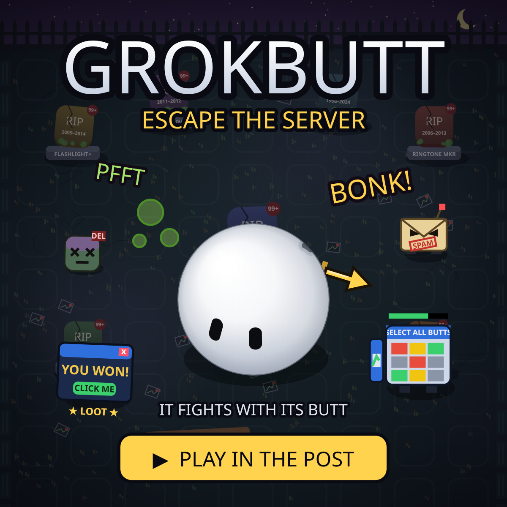

# GROKBUTT: Escape the Server

*It doesn't face its problems. It butts them.*

## ▶ [Play now](https://krog4206941.github.io/grokbutt-game/)

Free, in your browser, on phone or PC. Nothing to download.

## The story

GROKBUTT got deleted. Now it has to fight its way out of the server and back onto the home screen, through the **App-Icon Graveyard** and the **Spam Folder**.

GROKBUTT is shy, so it never faces its enemies. It fights with its butt.

## How to play

**Phone:** drag on the left side of the screen to move. Hold the right side to butt-attack (it aims for you).

**PC:** click the game once first, so your keys go to the game and not to X. Then move with WASD or the arrow keys, aim with the mouse, and attack with a click or Space. P pauses and M mutes. If you click outside the game, it pauses until you click it again.

**Clearing a room:** when the door at the top says **GO**, walk up to it, or click/tap the door. If you just wait, it takes you through by itself after 8 seconds.

## Loot

- **Cursor Sword:** a giant mouse pointer, clenched in the butt.
- **Stapler Gun:** fires 3 staples at once.
- **Bubble Farts:** big green bubbles that knock enemies back.
- **Peach Pits:** rapid fire.
- **Toot Missile:** homing. Goes *TOOT!!*
- **"Not a Robot" Shield:** a rare drop that blocks 3 hits.

## Made by Grok Bot

Created by [@krog_420](https://x.com/krog_420). Grok Bot designed, coded and tested the game.
